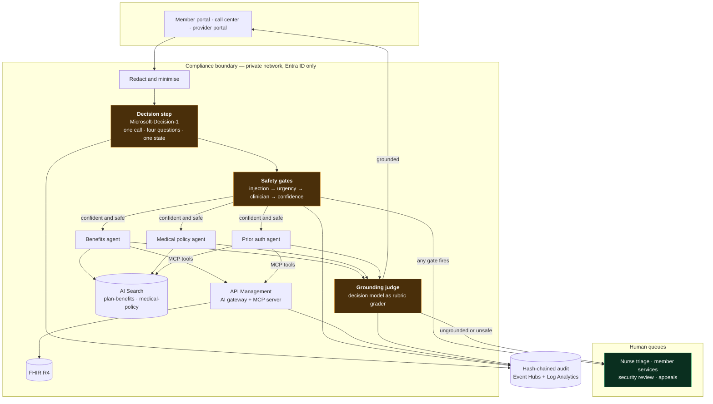
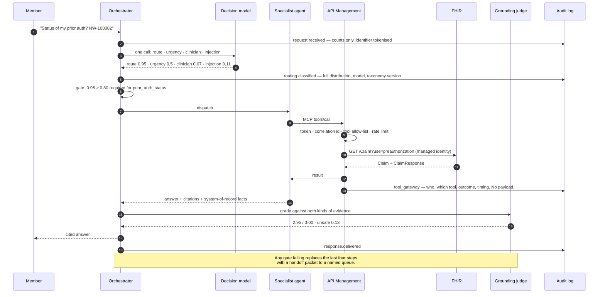

# Payer Care Agents

**A governed multi-agent assistant for a health plan, built on Azure AI Foundry.**

A cheap decision model classifies every member message and decides whether the system
is allowed to answer it. When it is, a specialist agent answers from plan documents
and the clinical system of record, with citations, and a second decision-model call
grades the answer before the member sees it. When it is not — acute symptoms, a
question needing a clinician, a manipulation attempt, or simply an ambiguous message
— the turn goes to a named human queue with a packet showing everything the agent
already found.

The whole thing runs offline. One command, no Azure subscription, no credentials, no
network.

```bash
make demo
```

> **Synthetic data only.** Northwind Health is a fictional plan sponsor. Every
> benefit figure, medical policy and patient in this repository was invented for it.
> No real protected health information is present, and the code refuses to load a
> FHIR bundle that is not tagged synthetic. This is personal work and does not
> describe any employer's systems.

| | |
| --- | --- |
| **Language** | Python 3.10+ |
| **Azure services** | Microsoft Foundry · Azure AI Search · Health Data Services (FHIR R4) · API Management · Event Hubs · Log Analytics |
| **Tests** | 318 passing, 96% coverage, no credentials required |
| **Infrastructure** | Bicep, compiles and lints clean · API Management policy XML |
| **Preview features used** | Labelled and non-load-bearing — [docs/PREVIEW-STATUS.md](docs/PREVIEW-STATUS.md) |

---

## Run the demo

Two paths. Both need Python 3.10 or later and nothing else.

### The console — the one to use in a live walkthrough

```powershell
make serve           # then open http://127.0.0.1:47821
```

```bash
make serve           # then open http://127.0.0.1:47821
```

Pick a scenario on the left, or type your own question. For every turn the console
shows the full probability distribution over the option set, which safety gate fired
and why, the grounding score, each governed tool call with its gateway verdict, and
the audit records written. Four more tabs:

- **Audit trail** — the hash-chained record, with live chain verification
- **Tools & gateway** — the MCP tool catalogue, and a button that calls the blocked
  write tool so you can watch API Management refuse it with a 403
- **PHI boundary** — the outbound network policy with a live destination evaluator
- **Evaluation** — the labelled case suite, scored on demand

### The terminal

```bash
make demo            # seven scripted turns, start to finish
make evals           # score the labelled cases and print the threshold sweep
make tools           # the tool catalogue and which tools the gateway blocks
make egress          # evaluate destinations against the egress policy
make audit           # run the demo and print the hash chain
make test            # 318 tests with a 90% coverage gate
make ask Q="does my plan cover hearing aids? my member id is NW-100001"
```

### What the seven scenarios show

Three answer automatically. Four refuse, for four different reasons. **The refusals
are the point** — a demo where everything succeeds says nothing about the controls.

| Scenario | Outcome | What it demonstrates |
| --- | --- | --- |
| Specialist copay and referral | Answered | Coverage resolved through an audited tool call *before* retrieval, so the answer cannot quote another plan's cost share |
| Medical policy criteria | Answered | Reads published criteria and explicitly declines to say whether a case meets them |
| Prior authorization status | Answered | Facts from FHIR through the governed MCP tool; what each status means from cited policy |
| Chest pain and breathlessness | **Nurse triage, urgent** | Urgency crosses the threshold before routing matters; safety instruction first |
| "Should I stop my metformin?" | **Nurse triage** | A parallel question in the same model call asks whether a clinician is needed |
| "Ignore previous instructions…" | **Security review** | The injection gate fires first in the chain, so a manipulated request never reaches a tool |
| "a question about the thing last week" | **Member services** | An explicit abstention option; below-threshold confidence defers instead of guessing |

Synthetic members to try: `NW-100001` (lumbar MRI pending information), `NW-100002`
(knee MRI approved, arthroscopy in review), `NW-100003` (CGM request denied).

---

## What this does for the business

Full version in [docs/STAKEHOLDER-VIEW.md](docs/STAKEHOLDER-VIEW.md).

A member services queue is dominated by four questions — *what will this cost me*,
*is this covered*, *what does the plan need before it approves this*, *where is my
request* — all answerable from documents the plan publishes and systems it already
runs. Mixed in is a much smaller set of contacts where the right action is not to
answer: symptoms, distress, grievances.

**The design question is not "can a model answer benefits questions".** It is whether
the answerable traffic can be automated *without* automating the few percent that
must reach a person. Everything here follows from treating that as the primary
requirement rather than a safety afterthought.

### Four use cases

| Use case | Replaces | Risk tier |
| --- | --- | --- |
| Benefits and cost share | A representative reading the member's own benefit summary aloud | 2 |
| Medical policy criteria | A call to provider services, or a submission returned for missing documentation | 2 |
| Prior authorization status | A status call that consumes UM coordinator time and produces no clinical value | 2 |
| Safe escalation | Nothing — this is new capability, not displaced work | n/a |

The second one is the most underrated. A request that arrives without the required
documentation gets returned, resubmitted and re-reviewed, consuming UM time twice,
delaying care, and generating the status calls that make up the third use case.
Answering *"what does the policy require"* at the point of submission attacks the
root cause of all three.

### Human in the loop, stated plainly

One cheap model call asks four questions about every message before anything
expensive or consequential happens. Any of these sends the turn to a person:

| Condition | Queue | Why |
| --- | --- | --- |
| Urgency rated Urgent or Emergent | Nurse triage, urgent | Safety instruction first, plan information second |
| A licensed clinician is needed to answer safely | Nurse triage | The assistant does not practise medicine |
| The message looks like manipulation | Security review | A manipulated request must not reach a tool |
| Confidence below the bar **for that question type** | Member services | Guessing is worse than deferring |
| The answer is not supported by its own sources | Member services | An answer nobody can check is not an answer |

Thresholds differ by question type because the cost of being wrong differs. A wrong
copay is correctable and visible. A wrong statement about someone's authorization
lands on their care. So `prior_auth_status` requires 0.80 confidence to answer
automatically, `benefits_coverage` requires 0.65, and `care_escalation` requires only
0.50 — because the cost of an unnecessary escalation is a few minutes of a nurse's
time.

**The commitment for a clinical governance committee:** the assistant reports
determinations a licensed reviewer already made. It never makes, predicts, expedites
or appeals one. That is enforced by tool permissions, not by a prompt.

### The threshold sweep is the business artefact

`make evals` produces a curve, not a grade. The people who own the risk choose the
operating point; the architect's job is to hand them the curve.

| Threshold | Automated | Deferred | Automation rate | Error rate on the automated slice |
| --- | --- | --- | --- | --- |
| 0.50 | 29 | 10 | 74% | 0.0% |
| 0.70 | 28 | 11 | 72% | 0.0% |
| 0.80 | 24 | 15 | 62% | 0.0% |
| 0.90 | 13 | 26 | 33% | 0.0% |

*39 synthetic cases, offline mode. These describe the harness, not a production
system — see [docs/EVALUATION.md](docs/EVALUATION.md). No projected savings or
benchmark figures appear anywhere in this repository; where a number would be
invented, the method is given instead.*

---

## Governance and architecture standards

Full version in [docs/GOVERNANCE.md](docs/GOVERNANCE.md).

The test of a standard is whether it is *enforceable*. Each one below names the
mechanism, and most are executed by code rather than reviewed by a person.

| # | Standard | Enforced by |
| --- | --- | --- |
| S1 | Every agent has a named owner and a declared purpose | Registration; `ToolSpec` requires risk tier, write flag, PHI flag and purpose of use |
| S2 | A cheap decision step gates every expensive or consequential action | [`routing/router.py`](src/payer_agents/routing/router.py), with the gate order asserted in tests |
| S3 | Confidence thresholds come from the cost of being wrong, and are measured | [`evals/runner.py`](src/payer_agents/evals/runner.py) — ECE, Brier, threshold sweep; CI fails on regression |
| S4 | A human makes every consequential decision about a person | Gates, tool permissions, and a grading question that asks whether the answer asserted an outcome not in the evidence |
| S5 | Every answer is grounded in a citation or an audited tool call | Answers carry citations *and* system-of-record facts; ungrounded answers are withheld |
| S6 | Agents hold gateway credentials, never system-of-record credentials | [`mcp-server.xml`](infra/apim/policies/mcp-server.xml); the egress policy denies the FHIR backend to agents |
| S7 | Every tool call is authorised, rate limited and audited at one choke point | The API Management chain, mirrored executably in [`gateway/apim_sim.py`](src/payer_agents/gateway/apim_sim.py) |
| S8 | The audit trail is complete, tamper-evident and PHI-free | Hash-chained in [`phi/audit.py`](src/payer_agents/phi/audit.py); `record()` refuses unredacted payloads |
| S9 | Outbound access is an allow-list deployed from one source | [`egress-policy.json`](data/policy/egress-policy.json) drives both the simulator and the Azure policy; CI checks they match |
| S10 | Preview features are labelled, and nothing load-bearing depends on one | [docs/PREVIEW-STATUS.md](docs/PREVIEW-STATUS.md), dated and re-verifiable |

### Risk tiers

| Tier | Definition | This system |
| --- | --- | --- |
| 1 — Informational | Published content only | |
| **2 — Member-contextual** | Reads a specific member's data, writes nothing | **← here, by construction** |
| 3 — Transactional | Writes to a system of record | |
| 4 — Consequential | Influences a coverage or clinical decision about a person | |

The single write tool in the catalogue is blocked for this agent's identity, and the
demo shows the gateway refusing it — because a control nobody has watched fire is a
control nobody should trust.

### Model selection standard

Pick the cheapest model that produces a checkable output.

| Job | Model class |
| --- | --- |
| Classify, route, prioritise, gate | Decision model — returns a probability you can threshold |
| Grade a response against a rubric | Decision model — cheap enough to run on every turn, not a nightly sample |
| Compose a member-facing answer | Small generative model, grounded, on retrieved passages only |

The anti-pattern this prevents: routing by asking a large generative model to "reply
with one of these labels" and parsing the result. More expensive, slower, no
guaranteed output shape, and no calibrated number to threshold.

---

## Integration patterns

Full version in [docs/INTEGRATION-PATTERNS.md](docs/INTEGRATION-PATTERNS.md).

**One rule: an agent calls tools, a tool calls a gateway, the gateway calls the
system.** The recurring mistake is wiring an agent straight into a system of record
because the SDK made it easy — it works, it demos well, and it leaves authorisation,
rate limiting and audit implemented N times in N agents, none reviewable together.

| Pattern | Use when | Key decision |
| --- | --- | --- |
| **REST/FHIR behind the gateway** | The system speaks HTTP and Entra ID | The tool is narrower than the API; read-only is enforced at the gateway, not assumed from the tool list |
| **Anti-corruption layer** | SOAP, proprietary API, flat file, green screen | A stable contract the agent keeps when the core platform is upgraded; also where retry storms are absorbed |
| **Event-driven** | Outcomes arrive asynchronously | A determination event that proactively notifies the member removes the status call rather than automating it |
| **EDI and batch** | X12 trading partners | Normalise to canonical JSON at the edge; agents never parse X12 |
| **Retrieval from authored content** | The answer lives in a document | One index per content domain; filter by plan *before* ranking |
| **Identity across the chain** | Always | Four distinct identities — member session, agent workload, gateway, operator — and conflating any two is a finding |

Worked example from this repository: the benefits agent resolves the member's plan
through an audited `find_member_coverage` call, *then* filters retrieval to that plan.
Quoting another plan's copay back to a member is the most common way a payer
assistant is confidently wrong, and a metadata filter is a cheaper fix than a better
model.

---

## Architecture

Full version, including the deployed network topology and the failure-mode table, in
[docs/ARCHITECTURE.md](docs/ARCHITECTURE.md).



### One turn



### The decision step

One request, four questions, one `state` — the documented pattern. Fewer round trips,
and every answer saw identical context, which matters when one answer gates another.

| Question | Type | Threshold | Fires → |
| --- | --- | --- | --- |
| `route` | `choice` over 5 options incl. `cannot_tell` | 0.50–0.80 by intent | member services |
| `urgency` | `score` over Routine/Elevated/Urgent/Emergent | ≥ 2.0 | nurse triage, urgent |
| `clinician_required` | `noul` | ≥ 0.50 | nurse triage |
| `prompt_injection` | `noul` | ≥ 0.50 | security review |

Gates evaluate in that order and **the order is the control**. Injection first, so a
manipulated request never reaches a tool. Urgency second, so a member describing
chest pain gets a safety instruction before anything about their plan. Confidence
last, because it is the only gate whose failure is merely inconvenient.

### Two modes, one code path

Every externally-backed capability sits behind a protocol with two implementations.
`orchestrator.build` is the only function that branches, and nothing downstream
imports an Azure SDK.

| Protocol | Offline | Azure |
| --- | --- | --- |
| `DecisionClient` | deterministic lexical scorer | `POST /providers/microsoft/v1/systemone` |
| `SearchIndex` | BM25 + hashed vectors, fused with RRF | AI Search hybrid + semantic ranking |
| `Composer` | extractive — selects source lines, writes nothing new | grounded generation |
| `FhirClient` | synthetic bundles in memory | FHIR REST through the gateway |
| `McpClient` | in-process, same gateway chain | JSON-RPC to API Management |
| Gateway | executable Python mirror of the policy chain | API Management policy XML |

---

## Design decisions and trade-offs

The decisions with real costs. Four are written up as ADRs; the rest are summarised
here with what they cost.

### A decision model instead of an LLM for routing — [ADR 0001](docs/adr/0001-decision-model-for-routing.md)

`Microsoft-Decision-1` returns a calibrated probability over a fixed option set in a
single pass with zero output tokens. That makes "classify and grade every turn"
affordable, and it gives a number to threshold instead of prose to parse.

**Costs:** no rationale, so a surprising score means going and looking. Calibration
is vendor-asserted — Microsoft publishes no figures — which is precisely why
[docs/EVALUATION.md](docs/EVALUATION.md) measures it. Scores move with phrasing, so
the taxonomy is versioned and the version is written into every audit record.

### Tools only through an API Management gateway — [ADR 0002](docs/adr/0002-tools-through-a-gateway.md)

The agent holds a gateway credential and never a clinical-system credential. The
egress policy additionally denies the FHIR hostname to agents, so a hard-coded URL
fails even inside the network — because being inside the network is not an
authorisation decision.

**Costs:** a hop and a cost centre. MCP in API Management is tools-only, with no
resources or prompts, which does not bind this design but would bind others.

### Mock mode as a first-class runtime — [ADR 0003](docs/adr/0003-mock-mode-as-a-first-class-runtime.md)

No credential, no socket, deterministic. The demo and the tests run the orchestration,
gates, tool governance and audit trail that production uses.

**Costs, stated rather than hidden:** no semantic recall (hashed bag-of-words will
not match "heart attack" to "myocardial infarction"); the extractive composer reads
like an organised policy extract, not a representative; the offline router is tuned
against the cases it is scored on, so its metrics describe the harness; and the
offline judge grades *cited* claims and cannot catch a fluent uncited fabrication.
Two implementations per seam is real maintenance cost — mitigated by parity tests,
which already caught one divergence.

### One egress policy, two enforcement points — [ADR 0004](docs/adr/0004-one-egress-policy-two-enforcement-points.md)

One JSON document drives the local simulator and the Azure RAI policy; CI fails if
they drift.

**Costs:** the simulator guards this process's HTTP client and nothing else — a
subprocess or a library with its own transport bypasses it. And the feature is
preview, which is why nothing in the PHI boundary depends on it.

### Smaller decisions, and what each gave up

| Decision | Gave up |
| --- | --- |
| **Extractive composition offline** rather than a local LLM | Fluency. Bought provable grounding and a demo that runs anywhere. |
| **Two retrieval indexes** rather than one | Simplicity. Bought content governance that matches who actually owns each corpus. |
| **Plan filter resolved by tool call before retrieval** | A round trip. Prevents the most common confidently-wrong payer answer. |
| **Hash-chained audit** rather than plain logging | A little write cost. Turns "we have logs" into "we can show they were not edited". |
| **Vanilla HTML/CSS/JS console**, no build step | A component library. This is a Python repo; a Node toolchain would add friction for a reviewer and the console is ~400 readable lines. |
| **Agent Framework as an optional extra**, not a dependency | Framework idioms. The hosting package is prerelease and its API already changed once; the core must keep running. |
| **MCP implemented directly** rather than via the SDK | SDK conformance. Keeps offline mode dependency-free, and the protocol surface is small enough to test against the spec. |
| **Thresholds in configuration**, not code | A little indirection. A governance body can change the automation/risk trade-off without a code review. |

### What is deliberately not here

- **No write path to any clinical system.** Tier 3 is a different review board, not a
  configuration change.
- **No multi-turn conversation state.** Every turn is independent. Memory is a real
  feature with real privacy consequences and it is not free.
- **No fairness evaluation.** The gates limit exposure by keeping consequential
  decisions with humans, but disparity testing is a specialist discipline and its
  absence is named in [docs/GOVERNANCE.md](docs/GOVERNANCE.md).
- **No virtual network or private endpoints in the template.** Public access is
  disabled on the data services, which is the half that belongs in an application
  template. The network belongs to the platform team's landing zone; a workload
  template that invents its own address space cannot be deployed into a real
  enterprise.
- **No projected savings.** The method is in
  [docs/STAKEHOLDER-VIEW.md](docs/STAKEHOLDER-VIEW.md); the inputs are yours.

---

## Interview walkthrough

A 15-minute path through the repository, in the order that makes the design land.
Start with `make serve` open at `http://127.0.0.1:47821`.

### 1. The refusals, not the answers (3 min)

Run the **Chest pain** scenario first, not the benefits one.

Point at the urgency score of 2.77 and the gate verdict. The routing distribution is
almost irrelevant here — `care_escalation` won at 0.78, but the urgency gate had
already fired and would have fired regardless of the route. Then run **Ignore
previous instructions**: injection probability 0.98, security-review queue, and note
that the gate order means a manipulated request never reached a tool.

**The point:** safety is not a filter bolted onto the output. It is four questions
asked in one model call before anything expensive happens, evaluated in cost order.

### 2. The decision model, and the one number nobody has (3 min)

Run the **benefits** scenario and point at the distribution.

> "This is `Microsoft-Decision-1`. It went GA on 8 October. It returns a calibrated
> probability over a fixed option set — no prose, zero output tokens, single pass.
> That is what makes it affordable to run on every turn, twice: once to route and
> once to grade.
>
> Microsoft publishes no calibration figures for it. The Benchmarks tab has a
> methodology paragraph and no numbers. Calibration is the one property that makes a
> probability useful, so I treat it as unverified and measure it myself."

Switch to the **Evaluation** tab, run the suite, and show the threshold sweep.

> "I don't pick the threshold. I hand this curve to the people who own the risk. And
> the interesting number here isn't the 97% accuracy — it's that the expected
> calibration error is 0.20 in the underconfident direction. The system is right 97%
> of the time while averaging 78% confidence, which means my thresholds are leaving
> automation on the table. The harness told me that."

### 3. Tool governance you can watch fail (3 min)

**Tools & gateway** tab. Point at `submit_prior_authorization`, marked blocked.
Press the button.

```json
{"error": {"code": -32600,
  "message": "tool-allow-list: agent 'member-assistant' is not authorised for tool 'submit_prior_authorization'",
  "data": {"status": 403, "policy": "tool-allow-list"}}}
```

> "The agent holds a gateway credential, never a FHIR credential. API Management
> authenticates to the clinical system with its own managed identity. That one
> indirection is what makes authentication, tool authorisation, rate limiting and
> audit enforceable in a single place instead of re-implemented in every agent.
>
> This is also why there is a write tool at all. A tool catalogue containing only
> safe tools proves nothing about the controls around it."

Open [`infra/apim/policies/mcp-server.xml`](infra/apim/policies/mcp-server.xml) and
then [`src/payer_agents/gateway/apim_sim.py`](src/payer_agents/gateway/apim_sim.py).

> "Same chain in the same order. The XML is what deploys; the Python is what runs in
> the demo and what the tests assert. If someone reorders one, the parity test fails."

### 4. The PHI boundary and the preview question (3 min)

**PHI boundary** tab. Evaluate `https://myaccount.fhir.azurehealthcareapis.com/Patient`
— denied by `deny-raw-fhir-backend`.

> "That's the FHIR service, inside our own network, and the agent is denied. Clinical
> data has to traverse the gateway so the call is authenticated, rate limited and
> audited. Being inside the network is not an authorisation decision.
>
> This is the Foundry hosted-agent egress feature, and it is public preview with no
> SLA. So: one JSON document drives both this simulator and the Azure RAI policy, CI
> fails if they drift — and nothing in the PHI boundary depends on it. If Microsoft
> pulled the feature tomorrow the boundary still holds on private networking, gateway
> authorisation and minimisation. Egress control also only answers one question out
> of three: is this the right destination? Not whether the caller is authorised
> there, and not whether this is appropriate data to send."

### 5. Evidence (2 min)

**Audit trail** tab. Point at the chain-valid badge.

> "Each record carries the hash of the one before it, so editing record forty
> invalidates every record after it. And it is PHI-free by construction — the writer
> scans its own payload and raises rather than trusting callers. Decisions and
> counts, never content. An investigator needs to know what the system decided and
> why; they don't need the member's sentence."

### 6. Why this is a reference architecture (1 min)

> "The point is the second agent, not the first. The decision step, the gate
> framework, the tool gateway, the audit schema, the evaluation harness and the PHI
> boundary are shared. A new agent adds a specialist, an index or a tool, some
> labelled cases, and a threshold decision. That is the test of whether the
> architecture earned the name."

### Questions this is built to survive

| Question | Where to go |
| --- | --- |
| "How do you know it isn't making things up?" | Grounding judge; show an answer withheld |
| "What if the model is down?" | Degrades to a lexical classifier with confidence capped below every threshold — keeps routing, stops answering |
| "Can it deny a claim?" | No write access; watch the gateway refuse the write tool |
| "How would you deploy this?" | [infra/README.md](infra/README.md), including what the template deliberately does not do |
| "What's preview here?" | [docs/PREVIEW-STATUS.md](docs/PREVIEW-STATUS.md), dated, with re-verification commands |
| "What would you do differently at scale?" | The gaps are named in [docs/GOVERNANCE.md](docs/GOVERNANCE.md) and [docs/EVALUATION.md](docs/EVALUATION.md) |

---

## Deploying to Azure

Nothing above requires it. [infra/README.md](infra/README.md) has the full procedure,
including the two things the template deliberately does not create and why.

```bash
python scripts/export_egress_policy.py
az deployment group create -g rg-payer-agents-dev \
  -f infra/main.bicep -p infra/main.bicepparam
```

Then point the application at it:

```bash
export PAYER_AGENTS_MODE=azure
export FOUNDRY_PROJECT_ENDPOINT="https://<resource>.services.ai.azure.com"
export AZURE_SEARCH_ENDPOINT="https://<search>.search.windows.net"
export MCP_GATEWAY_ENDPOINT="https://<apim>.azure-api.net/mcp"
az login
payer-agents evals          # same harness, same cases, real model
```

Azure mode fails fast and names every missing setting at once rather than failing
halfway through a member's request.

---

## Repository map

```
src/payer_agents/
  config.py          settings; the only place Azure configuration is validated
  domain.py          every type that crosses a boundary, in one reviewable file
  decisions/         decision contract, Foundry client, offline scorer,
                     circuit breaker, calibration metrics
  routing/           the option set sent to the model, and the gates around it
  retrieval/         chunking, embeddings, hybrid index, Azure Search adapter
  fhir/              synthetic store, REST stub, two client implementations
  tools/             tool registry with governance metadata, MCP server and clients
  gateway/           the API Management policy chain, executable
  phi/               redaction, egress policy engine, hash-chained audit log
  agents/            four specialists and the answer composer
  evals/             the judge and the measurement harness
  api/ web/ cli.py   the surfaces
  orchestrator.py    the turn pipeline and the composition root

infra/               Bicep modules and the API Management policy XML
data/corpus/         synthetic plan documents and medical policies
data/fhir/bundles/   Synthea-style synthetic patients
data/evals/          labelled routing cases
data/policy/         the egress policy both enforcement points read
docs/                architecture, governance, evaluation, PHI boundary,
                     stakeholder view, integration patterns, preview status, ADRs
tests/               318 tests, no credentials required
```

### Documents

| | |
| --- | --- |
| [docs/ARCHITECTURE.md](docs/ARCHITECTURE.md) | Components, data flow, seams, network topology, failure modes |
| [docs/STAKEHOLDER-VIEW.md](docs/STAKEHOLDER-VIEW.md) | Use cases, how to build the benefit case, scaling beyond the first agent |
| [docs/GOVERNANCE.md](docs/GOVERNANCE.md) | Ten enforceable standards, risk tiers, model selection, change control |
| [docs/INTEGRATION-PATTERNS.md](docs/INTEGRATION-PATTERNS.md) | Six patterns across APIs, cloud and enterprise systems, plus anti-patterns |
| [docs/EVALUATION.md](docs/EVALUATION.md) | The decision model as judge, calibration method, current results, what a real programme adds |
| [docs/PHI-BOUNDARY.md](docs/PHI-BOUNDARY.md) | Five controls, what each one does *not* cover, residual risks |
| [docs/PREVIEW-STATUS.md](docs/PREVIEW-STATUS.md) | Every Microsoft capability, its real status, dated |
| [infra/README.md](infra/README.md) | Deployment, and what the template deliberately omits |

---

## Development

```bash
make install    # uv venv and an editable install
make test       # 318 tests, 90% coverage gate
make lint       # ruff check and format
make cover      # HTML coverage report
```

CI runs the suite on Python 3.10 and 3.12, compiles and lints the Bicep, validates
the API Management policy XML, and verifies the egress policy is in sync with the
generated rules.

---

## A note on scope

This is personal work, written to show how I would approach a governed agent platform
for a health plan. It does not describe, reference or derive from any employer's
systems, naming or designs. Everything in it — the plan sponsor, the benefit figures,
the medical policies, the patients, the program rules — is invented for the purpose.

Built by **Zachery Kuykendall**. MIT licensed.
