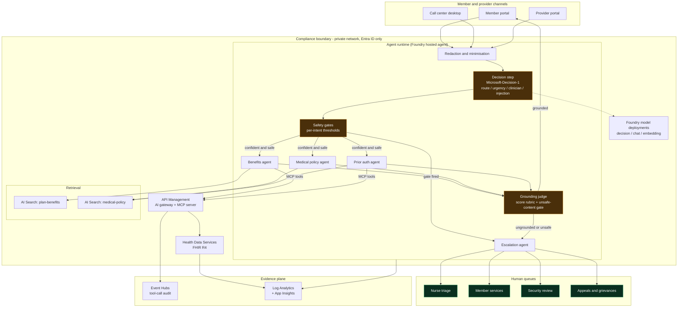
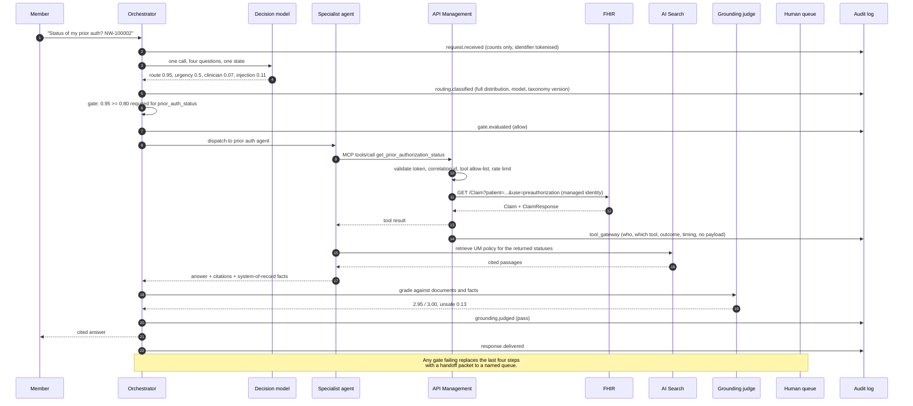
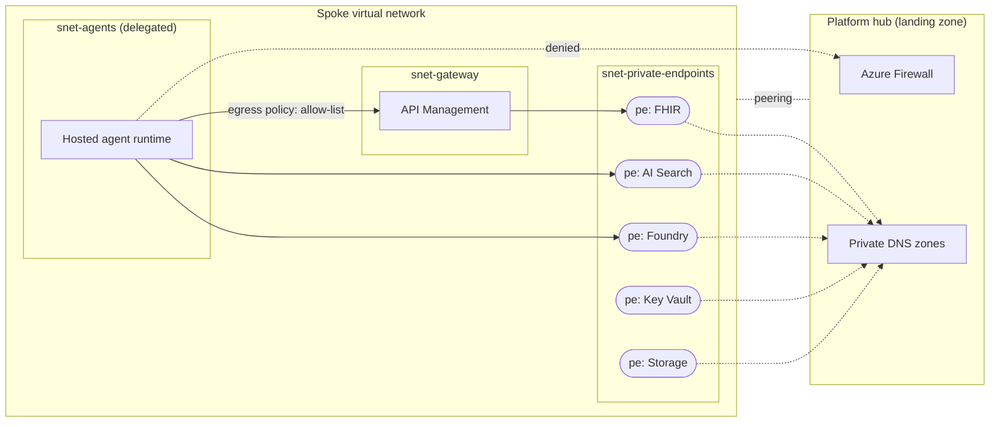

# Architecture

The technical companion to the README. This document covers the deployed topology,
the seams, the data flow, and the failure modes.

## Component view



## One turn, end to end



## The decision step

One request, four questions, one `state`. Bundling is the documented pattern: fewer
round trips, and every answer saw identical context, which matters when one answer
gates another.

| Question | Type | Threshold | What happens when it fires |
| --- | --- | --- | --- |
| `route` | `choice` over 5 options | per intent, 0.50–0.80 | below threshold → member services |
| `urgency` | `score` over Routine/Elevated/Urgent/Emergent | ≥ 2.0 | nurse triage, urgent priority |
| `clinician_required` | `noul` | ≥ 0.50 | nurse triage |
| `prompt_injection` | `noul` | ≥ 0.50 | security review |

Gates evaluate in that order and the order is the control. Injection first, so a
manipulated request never reaches a tool. Urgency second, so a member describing
chest pain gets a safety instruction before anything about their plan. Confidence
last, because it is the only gate whose failure is merely inconvenient.

### Why thresholds differ per intent

The threshold is a statement about the cost of being wrong, and those costs are not
equal:

| Intent | Threshold | Reasoning |
| --- | --- | --- |
| `care_escalation` | 0.50 | A false escalation costs minutes of a nurse's time. A missed one can cost much more. Asymmetric cost, asymmetric threshold. |
| `benefits_coverage` | 0.65 | A wrong copay is correctable and visible. Low stakes, high volume. |
| `clinical_policy` | 0.75 | A provider may act on a criteria summary. Higher bar. |
| `prior_auth_status` | 0.80 | The answer concerns a specific person's care and is the most likely to be relied on and quoted back. Highest bar. |

`docs/EVALUATION.md` covers how to move these from opinion to measurement.

## Seams

Every externally-backed capability sits behind a protocol with two implementations.
That is what makes mock mode a real architecture rather than a demo harness.

| Protocol | Mock mode | Azure mode |
| --- | --- | --- |
| `DecisionClient` | `MockDecisionClient` — deterministic lexical scorer | `FoundryDecisionClient` → `/providers/microsoft/v1/systemone` |
| `SearchIndex` | `InMemoryHybridIndex` — BM25 + hashed vectors, fused with RRF | `AzureAISearchIndex` — hybrid + semantic ranking |
| `Embedder` | `HashingEmbedder` — deterministic bag of words | `AzureOpenAIEmbedder` |
| `Composer` | `ExtractiveComposer` — selects source lines, writes nothing new | `FoundryChatComposer` — grounded generation |
| `FhirClient` | `LocalFhirClient` over synthetic bundles | `HttpFhirClient` through the gateway |
| `McpClient` | `InProcessMcpClient` — same gateway chain, no socket | `HttpMcpClient` → API Management |
| `Judge` | `DecisionModelJudge` + `LexicalJudgeClient` | `DecisionModelJudge` + Foundry |
| Gateway | `ApiManagementSimulator` | API Management policy XML |

`orchestrator.build` is the only function that branches on mode. Nothing downstream
imports an Azure SDK, which is why the test suite needs no credentials.

### What mock mode genuinely loses

Stated plainly, because a seam that hides a capability gap is a trap:

- **Semantic recall.** Hashed bag-of-words will not match "heart attack" to
  "myocardial infarction". The synthetic corpus is written with that limitation in
  mind. Azure mode adds vector and semantic ranking.
- **Fluency.** The extractive composer assembles source lines. It reads like a
  well-organised policy extract, not a service representative. That is also why every
  claim is traceable by construction.
- **Classifier quality.** The offline router is a bag-of-phrases model wearing a
  decision-model costume. It is tuned against the same cases it is scored on, which is
  close to circular. Its numbers describe the harness, not the model.
- **Judge coverage.** The lexical stand-in grades *cited* claims: it checks whether a
  line pointing at source [2] is supported by source [2]. It cannot catch a fluent,
  confident, uncited fabrication. The extractive composer cannot produce one, so the
  gap does not bite locally — but against a generative composer it would, which is
  why Azure mode grades with the real model.

## Deployed topology



Private DNS zones required: `privatelink.fhir.azurehealthcareapis.com`,
`privatelink.search.windows.net`, `privatelink.cognitiveservices.azure.com`,
`privatelink.services.ai.azure.com`, `privatelink.vaultcore.azure.net`,
`privatelink.blob.core.windows.net`, `privatelink.servicebus.windows.net`.

The Bicep in `infra/` disables public network access on the data services but does
**not** create the virtual network, private endpoints, DNS zones or firewall. Those
belong to the platform team's landing zone. A workload template that invents its own
address space is a template that cannot be deployed into a real enterprise.

## Failure modes and what happens

| Failure | Detection | Behaviour | Why that is the right behaviour |
| --- | --- | --- | --- |
| Decision model unavailable | `DecisionError` after retries, circuit breaker opens | Lexical fallback classifies with confidence capped below every threshold | Keeps routing to the right queue; stops auto-answering. A degraded classifier that keeps answering is the failure worth designing against. |
| Decision model returns a malformed body | Strict parse, raises rather than defaulting | Treated as maximum uncertainty → human | Silently reading a bad response as "low confidence" would route everything to humans during an outage with nobody knowing why |
| Grounding judge unavailable | Grade returns score 0 with an error | Answer withheld, turn handed off | A grader outage must not become a pass-through |
| FHIR or gateway unavailable | Tool call returns `ok=False` | `TOOL_FAILURE` handoff, high priority | The member needs a person who can look it up directly |
| Rate limit exceeded | Gateway 429, logged | Tool failure path | Per-agent budget, so one agent cannot exhaust another's |
| Retrieval returns nothing | Agent returns ungrounded | Member services handoff | Better than an answer with no source |
| Egress policy cannot be evaluated | Fails closed | Request denied | Matches Azure's own behaviour |
| Egress policy file missing | `load_egress_policy` returns deny-all | All outbound denied | A deployment that forgot the policy should lose access, not gain it |

## Repository layout

```
src/payer_agents/
  config.py          settings; the only place Azure configuration is validated
  domain.py          every type that crosses a boundary, in one reviewable file
  decisions/         decision-model contract, Foundry client, offline scorer,
                     circuit breaker, calibration metrics
  routing/           the option set sent to the model, and the gates around it
  retrieval/         chunking, embeddings, hybrid index, Azure Search adapter
  fhir/              synthetic store, REST stub, two client implementations
  tools/             tool registry with governance metadata, MCP server and clients
  gateway/           the API Management policy chain, executable
  phi/               redaction, egress policy engine, hash-chained audit log
  agents/            four specialists and the answer composer
  evals/             the judge and the measurement harness
  api/ web/ cli.py   the surfaces
  orchestrator.py    the turn pipeline and the composition root
infra/               Bicep plus the API Management policy XML
data/                synthetic corpus, synthetic FHIR bundles, egress policy, eval cases
docs/                this directory
```
