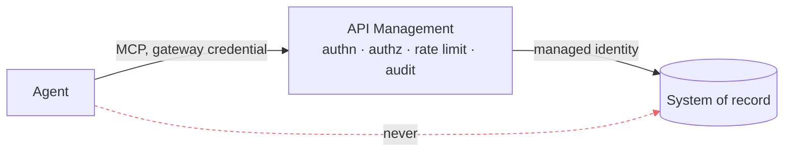
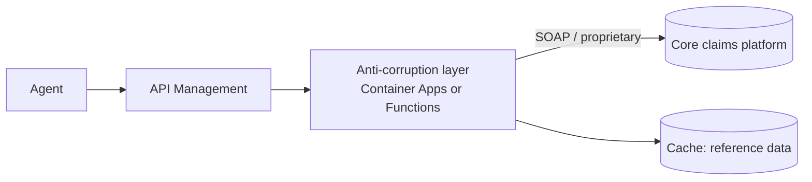
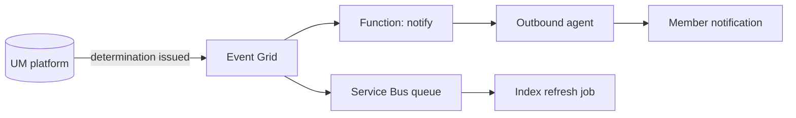
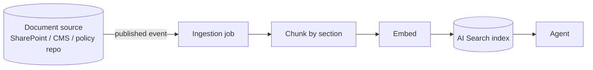

# Integration patterns

How an agent platform connects to the systems a health plan already runs — the core
claims platform, utilization management, CRM, EDI partners, the data warehouse — and
which pattern to reach for in each case.

The recurring mistake this document exists to prevent: wiring an agent directly to a
system of record because the SDK made it easy. It works, it demos well, and it leaves
you with authorisation, rate limiting and audit implemented N times in N agents, none
of them reviewable together.

---

## The one rule

**An agent calls tools. A tool calls a gateway. The gateway calls the system.**



Everything below is a variation on where the gateway's backend points and how the
system of record is reached.

---

## Pattern 1 — Modern REST or FHIR behind the gateway

**Use when** the system speaks HTTP and supports Entra ID or OAuth.

This is the FHIR path in this repository. API Management fronts the service,
authenticates with its own managed identity, and the agent holds only a gateway
credential.

```
Agent → MCP tools/call → APIM MCP server → FHIR R4 → Claim + ClaimResponse
```

Two decisions worth copying:

- **The tool is narrower than the API.** `get_prior_authorization_status` exists;
  `search_claims` does not. The MCP server exposes selected operations as tools, and
  that selection is a governance decision — which capabilities an agent is permitted
  to have — not a convenience one.
- **Read-only is enforced at the gateway, not assumed from the tool list.** A tool
  definition is configuration. `infra/apim/policies/fhir-api.xml` rejects any verb
  other than GET, so a misconfigured tool catalogue cannot turn a read-only agent
  into a writing one.

**Watch out for:** FHIR search semantics do not map one-to-one onto a useful tool. A
member asking "where is my request" wants the newest one, so the ordering is part of
the tool contract rather than a presentation detail. Both FHIR clients in this
repository sort newest-first, and a parity test enforces it after one of them quietly
did not.

---

## Pattern 2 — Legacy core platform behind an anti-corruption layer

**Use when** the system is a claims or membership platform with a SOAP interface, a
proprietary API, a flat-file drop, or a green screen.

Do not let the agent see it. Put a small service in front that exposes a clean
domain-shaped contract and absorbs the legacy weirdness.



What the layer earns:

- **A stable contract.** The agent's tool definition does not change when the core
  platform is upgraded.
- **Semantic translation.** Internal status codes become the vocabulary the plan
  publishes to members. This repository does a small version of this in
  `fhir/store.py`: `ClaimResponse.outcome` is a narrow FHIR code set, so it is mapped
  once to the operational statuses published in the UM policy, in one place rather
  than in three agents.
- **A rate-limit shock absorber.** A core platform sized for 200 concurrent users
  does not survive an agent retry storm. The layer is where that is contained.
- **A seam for caching.** Benefit configuration changes annually; nothing downstream
  should be calling the core for it per turn.

**Watch out for:** the layer becoming a dumping ground. It translates and protects.
It does not accumulate business logic, because logic that lives there is logic no
agent's audit trail can explain.

---

## Pattern 3 — Event-driven integration for asynchronous work

**Use when** the outcome is not available within a request, or when a change in one
system should wake something up.



Where this belongs in a payer context:

- **Determination issued** → proactively notify the member, which removes the status
  call entirely rather than automating it. The best handled contact is the one that
  never happens.
- **Policy document published** → re-chunk and re-index. The retrieval index must not
  be refreshed on a timer and hoped about; publication is an event and should behave
  like one.
- **Authorization expiring** → outreach before the member discovers it at the
  pharmacy counter.

**Watch out for:** an agent in an event handler has no user to ask and no one to defer
to. Everything an interactive agent escalates, an event-driven agent must either
handle autonomously or queue for a human — so event-driven agents should be lower
tier, not higher.

---

## Pattern 4 — EDI and batch partners

**Use when** the counterparty is a clearinghouse or a trading partner on X12.

X12 is not going away. The 278 transaction carries prior-authorization requests and
responses, 835 carries remittance, 837 carries claims. An agent has no business
parsing X12.

```
Partner → SFTP / AS2 → Integration Account (or Logic Apps) → canonical JSON
        → event → the same tools every other consumer uses
```

The rule: **normalise at the edge, and let agents consume the canonical form.** The
boundary where X12 becomes a domain object is the boundary where agent governance
starts.

**Watch out for:** file-based partners carry PHI in bulk, with retention and transit
rules that differ from interactive traffic. This is the integration most likely to
need its own privacy review, and the one most likely to be treated as plumbing.

---

## Pattern 5 — Retrieval from authored content

**Use when** the answer lives in a document rather than a system.



Decisions that matter more than the model:

- **One index per content domain, not one big one.** Plan benefits and medical policy
  have different owners, different refresh cadences and different review boards.
  Splitting them in the architecture makes "who approves a change to this content"
  answerable, and lets the benefits index carry plan-scoped filtering that medical
  policy does not need.
- **Chunk on the document's own structure.** Payer documents are heavily sectioned,
  and the section heading is usually the single most useful thing in a citation.
- **Filter before you rank.** Quoting another plan's copay back to a member is the
  most common way a payer assistant is confidently wrong. The benefits agent resolves
  the member's plan through a tool call *before* retrieving, then filters on it. A
  metadata filter is a cheaper fix than a better model.
- **Effective dating is a first-class field.** "What does the plan cover" has a
  different answer in December and January, and a retrieval layer with no concept of
  a plan year will answer confidently with last year's document.

---

## Pattern 6 — Identity and authorisation across the chain

Four distinct identities, and conflating any two of them is a finding:

| Identity | Who it is | What it may do |
| --- | --- | --- |
| **Member session** | The human, authenticated at the channel | Establishes whose data is in scope |
| **Agent workload identity** | The agent runtime | Call the gateway. Nothing else. |
| **Gateway managed identity** | API Management | Call the backend, scoped by RBAC |
| **Operator identity** | A human running the platform | Read models and indexes. No FHIR data-plane grant by default. |

The member's scope travels as a claim, not as a parameter an agent can choose.
`infra/apim/policies/fhir-api.xml` rejects any request that targets a member outside
the token's `member_scope`, so an agent that is manipulated into asking for a
different member gets a 403 from the gateway rather than a record.

**Watch out for:** the temptation to give the agent a broad service identity "for
now". It is never revisited, and it is the single most common way an agent platform
ends up with a blast radius nobody can describe.

---

## Choosing between them

| If the system… | Use | Because |
| --- | --- | --- |
| Speaks HTTP and Entra ID | Pattern 1 | Nothing in between to maintain |
| Is SOAP, proprietary, or a screen | Pattern 2 | The agent's contract should outlive the platform |
| Produces outcomes asynchronously | Pattern 3 | A request/response tool cannot wait hours |
| Is a trading partner on X12 | Pattern 4 | Normalise at the edge, govern downstream |
| Holds authored content | Pattern 5 | Retrieval, not an API |
| Any of the above | Pattern 6 | Identity is not optional in any of them |

---

## Anti-patterns

| Anti-pattern | Why it is attractive | What it costs |
| --- | --- | --- |
| Agent holds a system-of-record credential | One fewer hop; the SDK makes it a three-line change | Blast radius is the system of record. Authorisation, rate limiting and audit become per-agent problems. |
| One tool per API endpoint | Mechanical, feels complete | The tool catalogue becomes the API surface. Capability granted by default rather than by decision. |
| Agent parses X12, HL7v2, or a fixed-width file | "It's just parsing" | Format churn becomes agent churn, and the agent's audit trail now spans a parsing bug |
| Retrieval index refreshed on a timer | Simple | Nobody can say which document version answered a given turn |
| One shared retrieval index for everything | Fewer resources | Content governance collapses into one undifferentiated pile |
| Per-agent audit logging | Each team ships faster | No investigator can answer a cross-agent question |
| Caching member-specific responses | Latency | Stale clinical data, and a cache is now a PHI store with its own retention obligations |
