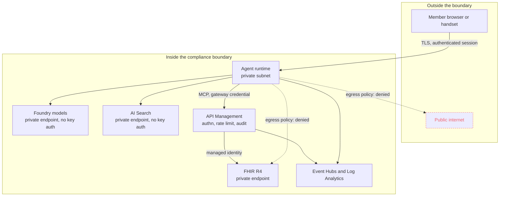

# The PHI boundary

Where protected health information may travel, what stops it travelling elsewhere,
and what each control does and does not cover.

> Everything in this repository runs on synthetic data. The plan sponsor is
> fictional, the policy documents are invented, and the patients are Synthea-style
> fabrications. `FhirStore.load_bundle` refuses any bundle not tagged `synthetic`, so
> dropping a real export into `data/fhir` fails on the first run rather than
> succeeding quietly.

---

## The boundary



Two denials in that diagram are doing real work:

- **The public internet is denied by default.** An allow-list, not a block-list.
- **The FHIR backend is denied to the agent**, even though it is inside the boundary.
  Clinical data must traverse API Management so the call is authenticated, rate
  limited and audited. An agent that can reach FHIR directly has bypassed all three,
  and "inside the network" is not an authorisation decision.

---

## Five controls, and what each one actually covers

### 1. Minimisation at the edge

The smallest control and the most effective. The agent asks for the member's plan and
the status of their authorizations — never a full record. Tool schemas are narrow by
construction: there is no `get_patient_everything`, and adding one would be a
reviewable change to a file whose diff a security reviewer reads.

**Covers:** the volume of PHI in motion.
**Does not cover:** anything about the data that legitimately does move.

### 2. Redaction before logging and before the model

`phi/redaction.py` replaces structured identifiers with stable, reversible tokens:
member ID, SSN, MRN, phone, email, date of birth, ZIP+4. Tokens are stable within a
conversation, so the agent can still make a tool call with the real value — the token
map never leaves the `Redactor` instance.

Authorization references such as `PA-20260207` are deliberately **not** redacted.
They look like identifiers but are plan artefacts, and stripping them would break the
prior-authorization flow for no privacy gain.

**Covers:** structured identifiers in logs, traces and model inputs.

**Does not cover —** and this is the honest part:

- Free-text names. "This is Aaron Brekke calling" passes through.
- Employer names, provider names, facility names.
- A rare diagnosis in a small population, which can identify someone on its own.
- Anything the regex authors did not anticipate.

For a production boundary, regex de-identification is **one layer in a stack**, not
the stack. The others are Azure AI Language PII detection, a reviewed allow-list of
fields permitted to leave the trust boundary, and a BAA with every processor. Most
importantly: redaction governs what gets *logged and shown*. It is not a substitute
for the boundary itself, and a design that leans on it as one has misunderstood what
it is for.

### 3. Network egress controls

`data/policy/egress-policy.json` is one document with two enforcement points:
`GuardedTransport` locally, and a Cognitive Services Responsible AI policy in Azure.
`scripts/export_egress_policy.py --check` runs in CI so they cannot drift.

Ordered rules, first match wins, FQDN matching with wildcards, default deny, and
`Audit` before `Enforced`.

```bash
payer-agents egress \
  https://apim-payer-agents.azure-api.net/mcp \
  https://myaccount.fhir.azurehealthcareapis.com/Patient \
  https://api.openai.com/v1/chat/completions
```

**Covers:** one question out of three — *is this the right destination?*

**Does not cover:** *is the caller authorised there* (allowing a host does not grant
access on it) and *is this appropriate data to send* (the payload is not inspected).
Those are answered by API Management and by minimisation respectively.

> **Preview.** Network egress controls for Foundry hosted agents are in public
> preview, carry no preview SLA, and Microsoft states they are not intended for
> production. See `PREVIEW-STATUS.md`. **Nothing in the PHI boundary depends on
> them.** If the feature were withdrawn tomorrow, the boundary would still hold on
> private networking, gateway authorisation and minimisation. Egress control is a
> cheap, auditable extra layer, and that is how it is positioned.

### 4. Gateway authorisation and audit

Every tool call passes one policy chain: Entra ID token validation, a required
correlation id, a tool allow-list for the calling agent identity, a per-agent rate
limit and quota, adversarial-input screening, and an audit record emitted whether the
call succeeded, failed, or was rejected.

The audit record carries metadata only: who called, which tool, the outcome, the
timing, the purpose of use, and the correlation id. No request body, no response
body, no member identifier. The clinical detail lives in the FHIR service's own audit
log, joinable to this record by correlation id — two logs with different access
control, joined on demand.

**Covers:** authorisation, abuse rate, and attribution.

### 5. Tamper-evident audit trail

`phi/audit.py` hash-chains every record. Altering record *n* invalidates every record
after it, which turns "we have logs" into "we can show the logs were not edited".

`AuditLog.record` scans its own payload for unredacted identifiers and raises
`PhiLeakError` rather than trusting the caller. A control that depends on every
future contributor remembering it is not a control.

```bash
payer-agents audit        # runs the demo and prints the chain
```

**Covers:** evidence integrity.
**Does not cover:** the local JSONL sink is not itself tamper-proof. The hash chain
carries the integrity claim; in production the destination is Event Hubs into a Log
Analytics workspace with an immutability policy, or storage under legal hold.

---

## What the audit trail records for one turn

| Category | Recorded | Deliberately not recorded |
| --- | --- | --- |
| `request` | channel, character count, redaction counts by category, whether a member was identified | the message |
| `routing` | intent, confidence, full probability distribution, urgency, both gate probabilities, model, provider, taxonomy version, latency | the state sent to the model |
| `gate` | allow or defer, which gate, the threshold, the explanation | — |
| `tool_gateway` | agent id, tool name, gateway policy and status, purpose of use, correlation id, duration, record count | arguments, results, member id |
| `agent` | agent name, citation ids, tool outcomes, notes | the answer text |
| `grounding` | score, label, unsafe probability, threshold, judge provider and model | the graded text |
| `response` / `handoff` | agent or reason, queue, priority, citation count | member-facing text |

The pattern: **decisions and counts, never content.** Someone reconstructing an
incident needs to know what the system decided and why. They do not need the member's
sentence, and giving it to them widens the set of people who have seen PHI.

---

## Data classification

| Class | Examples | Where it may live |
| --- | --- | --- |
| **PHI** | Member identifiers, conditions, medications, authorization determinations | Inside the boundary only. FHIR, the agent runtime in memory, the FHIR service's own audit log. |
| **Tokenised PHI** | `[MEMBER_ID_1]`, correlation ids | Audit log, traces, handoff packets |
| **Plan content** | Benefit summaries, medical policies, formulary rules | AI Search, the retrieval index, citations. Not PHI. |
| **Operational metadata** | Confidence, latency, gate outcomes, tool names | Telemetry, dashboards, evaluation reports |

The classification is what makes the audit schema decidable. Every field in a record
belongs to one of these classes, and only the bottom two are allowed in it.

---

## Residual risks

Named, because a boundary document that lists only its strengths is marketing.

| Risk | Current mitigation | Honest gap |
| --- | --- | --- |
| Free-text PHI reaches a model or a log | Regex redaction | Names and contextual identifiers pass through. Needs PII detection as a second layer. |
| An agent is tricked into a tool call outside the member's scope | Injection gate, tool allow-list, member-scoped token policy in `fhir-api.xml` | The injection gate is one classifier with a small labelled set. Not an adversarial programme. |
| A new tool widens the surface without review | `ToolSpec` requires risk, write and PHI declarations; code review | Depends on reviewers actually reading the declaration |
| Egress policy is deployed in Audit and never switched to Enforced | Rollout order documented in `infra/README.md` | Nothing enforces the second step. Should be a deployment gate. |
| An operator queries PHI from a telemetry workspace | Separate sinks, separate RBAC, no bodies logged | Depends on the landing zone's RBAC being right |
| The grounding judge drifts | Scored on every turn | No human-review sample to keep the judge honest. Named as a gap in `EVALUATION.md`. |
